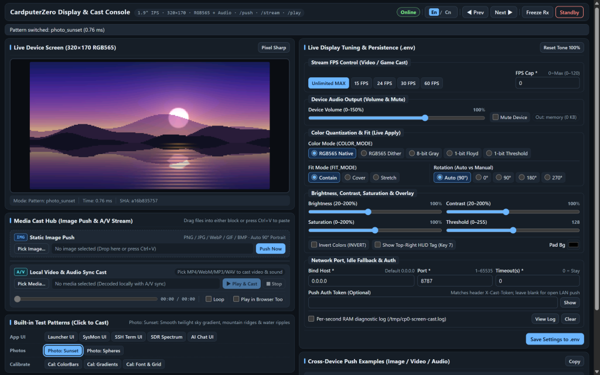
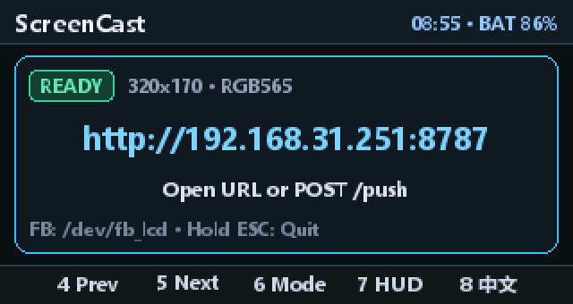
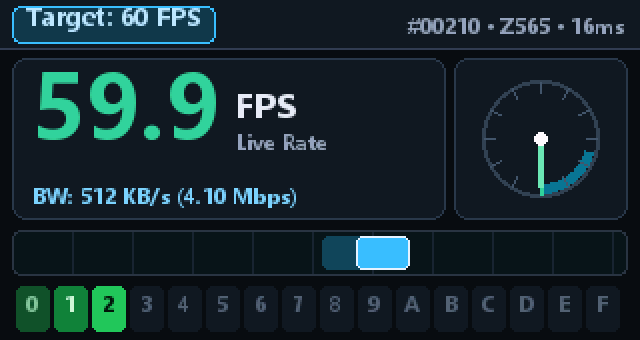

# CardputerZero 网页控台与无线投屏工具（ScreenCast）

**中文** | **[English](README_EN.md)**

面向 M5Stack CardputerZero（Raspberry Pi CM0 `aarch64`，Debian 13，1.9 英寸 ST7789v3 IPS 彩屏，物理分辨率 `320 × 170`，小端序 `16-bit RGB565`）开发的设备端画面评估、远程控台与高速无线投屏应用。

应用直接运行在 CardputerZero 设备上，启动后监听局域网 HTTP 端口（默认 `:8787`），提供三项核心能力：

1. **设备自托管双栏网页控台**：电脑或手机浏览器打开设备屏幕显示的 `http://<设备IP>:8787`，即可实时查看设备显存的 `320 × 170` 16-bit 量化镜像，支持 `En / Cn` 中英双语切换、选图/拖拽/`Ctrl+V` 剪贴板贴图上屏、10 类内置屏幕评估样张一键切换、色彩量化/防色带抖动/缩放/旋转/亮度/对比度/饱和度实时调参，以及针对视频播放与游戏推流的 **FPS 稳帧控制（固定 `1–120 FPS` 或 `0` 不限速）**。
2. **开放式局域网投屏接口（`POST /push`）**：任意设备、命令行或自定义程序可通过标准 HTTP POST 推送常规图片（PNG / JPEG / BMP / WebP / GIF）、裸 `108,800` 字节小端 `RGB565` 原始帧，或 `deflate` 极速无损压缩帧，由设备通过 `mmap` 直接刷入 `/dev/fb_lcd`（`/dev/fb0`）。
3. **PC 本地多速率连续推流测速器（`pc_fps_tester.py`）**：内置桌面可视化窗口与命令行巡检工具，支持按 `1–60 FPS` 及 `MAX` 全速连续推送动态测速画面，直观评估当前 Wi-Fi 环境下的真实帧率上限与画面流畅度。

---

## 界面与画面预览（En UI）

### 网页端双栏控台（`http://<设备IP>:8787`）



### 设备端 `320 × 170` 屏幕画面

| 设备端待机画面 | 内置测试图片 | 连续推流 FPS 测速画面 |
| :---: | :---: | :---: |
|  |  |  |

---

## 1. 屏幕规格与实机性能基准

| 项目 | 参数 / 实机实测指标（CardputerZero 2.4GHz Wi-Fi） |
| --- | --- |
| 物理屏幕 | 1.9" ST7789v3 IPS LCD，分辨率 `320 × 170` |
| 帧缓冲设备 | `/dev/fb_lcd` / `/dev/fb0`（小端序 `16-bit RGB565`，行距 `640` 字节，单帧 `108,800` 字节） |
| 运行依赖 | Python 3.11+ 标准库 + `Pillow`（设备端可选 `evdev` 监听机身键盘，零第三方 Web 框架依赖） |
| `rgb565_zlib` 推流峰值 | **`180+ FPS`**（单帧压缩后约 `6–8 KB`，设备端解压+刷屏约 `2.1 ms`，`60 FPS` 满刷仅占约 `512 KB/s`） |
| `JPEG (4:4:4)` 推流峰值 | **`41+ FPS`**（单帧约 `15 KB`，设备端解码+刷屏约 `21.5 ms`，带宽约 `690 KB/s`） |
| `Raw RGB565` 裸帧峰值 | **`37+ FPS`**（单帧固定 `108,800` 字节，设备端刷屏约 `2.8 ms`，实测 Wi-Fi 吞吐约 `4.0 MB/s`） |
| 控台稳帧精度 | 客户端全速灌入时，控台设 `24 / 30 / 60 FPS` 实测稳定在 **`23.8 / 30.1 / 59.2 FPS`** |

---

## 2. 目录结构

```text
ScreenCast/
├─ cp0_cast_app.py          设备端主程序（HTTP 服务 + 网页控台 + 图像管线 + /dev/fb0 驱动 + evdev 键盘）
├─ pc_fps_tester.py         PC 本地多速率连续推流 FPS 测速应用（Tkinter 桌面窗口 + CLI 巡检）
├─ build_deb.py             纯 Python 打包脚本（生成符合 APPLaunch 规范的多尺寸图标与 arm64 .deb 包）
├─ deploy_to_device.ps1     SSH 上传并安装 .deb 的辅助脚本
├─ .env.example             运行参数模板（含中文行内说明）
├─ .gitignore               Git 忽略配置（排除 .env、dist/ 与临时文件）
├─ todo.md                  开发范围、样张设计与验收清单
├─ README.md                中文使用与推流开发文档
├─ README_EN.md             英文使用与推流开发文档
├─ assets/                  APPLaunch 启动器多尺寸图标与 README 预览截图
├─ web/                     双栏网页控台前端（index.html / app.css / app.js）
└─ tests/                   设备端服务与 PC 测速器自动化单元测试套件
```

---

## 3. 安装、启动与日常使用

### 3.1 构建 `.deb` 安装包并部署到 CardputerZero

在项目根目录下无需安装交叉编译链或 Linux 打包工具，直接用 Python 生成标准 `arm64` Debian 包：

```powershell
# 1. 生成图标与安装包（输出至 dist/cp0-screen-cast_0.2.0_arm64.deb）
python "build_deb.py"

# 2. 通过 SSH 上传并安装到设备（假设 SSH 别名或主机为 cardputer / pi@192.168.31.251）
powershell -ExecutionPolicy Bypass -File "deploy_to_device.ps1" -Target "cardputer"
```

也可以手动通过 `scp` 上传后在设备上执行 `sudo dpkg -i /tmp/cp0-screen-cast_0.2.0_arm64.deb`。安装包会自动将应用注册到 `/usr/share/APPLaunch/applications/cp0-screen-cast.desktop`，`APPLaunch` 桌面通过 `inotify` 实时识别，无需重启机器。

### 3.2 设备端启动与物理按键操作

在 CardputerZero 的 `APPLaunch` 桌面选中 **`ScreenCast`** 打开，屏幕立即进入待机信息页并显示当前局域网访问地址（例如 `http://192.168.31.251:8787`）。

| 机身物理按键 | 功能说明 |
| --- | --- |
| `4` / `←` / `Z` | 切换到上一张内置评估样张 |
| `5` / `→` / `C` | 切换到下一张内置评估样张 |
| `6` | 循环切换色彩渲染模式（`rgb565` -> `rgb565_dither` -> `gray` -> `mono_floyd` -> `mono_threshold`） |
| `7` | 开关屏幕右上角状态角标（如 `CAST·30F·565`） |
| `8` / `L` | 切换中英文界面（`Cn` 中文 / `En` 小屏英文简称，与网页控台双向同步） |
| 短按 `ESC` / `0` / `Backspace` | 清空当前样张或推流画面，返回待机 IP 地址页 |
| **长按 `ESC`（约 0.7 秒）** | 退出 `ScreenCast` 并自动清屏交还 `APPLaunch` 启动器 |

如需脱离 `APPLaunch` 开机后台常驻运行，可在设备上执行：

```bash
# 启用开机后台自启
sudo systemctl enable --now cp0-screen-cast.service

# 停用后台自启（恢复由 APPLaunch 手动启动）
sudo systemctl disable --now cp0-screen-cast.service
```

### 3.3 本地电脑无硬件预览调试

在 Windows、macOS 或普通 Linux 电脑上直接运行 `cp0_cast_app.py` 时，程序检测到无 CardputerZero 帧缓冲设备会自动回退至内存虚拟显存，所有 HTTP 接口与网页控台功能均可正常调试：

```powershell
python "cp0_cast_app.py" --host 127.0.0.1 --port 8787
```

随后在浏览器打开 `http://127.0.0.1:8787/` 即可操作。

### 3.4 网页控台与配置项说明（`.env`）

浏览器访问 `http://<设备IP>:8787` 进入对称双栏控台：

- **左栏**：
  - **设备屏幕实时预览**：按设备真实 `RGB565` 显存字节还原画面，支持切换“像素锐利 / 平滑缩放”。
  - **快速推图区**：支持点击选择图片、拖拽图片文件到虚线框，或在页面任意位置直接按 **`Ctrl+V` 粘贴截图**即刻推送上屏。
  - **本地音视频文件投播区**：支持直接点选或拖入 `.mp4 / .webm / .mov / .mp3 / .wav` 文件，由手机或电脑浏览器本地解码，自动抽帧转 `RGB565` 推屏并提取 `24kHz PCM` 音频同步发往设备扬声器/耳机播放，带播放/暂停、进度条拖动、循环与本机监听开关。
  - **10 类内置评估样张库**：涵盖启动器列表、系统监控看板、SSH 终端日志、SDR 频谱瀑布图、AI 对话气泡阅读、日落山湖照片、3D 霓虹高光球体、8 色灰阶标定卡、四通道色带对比卡、1px 边框与字号对照卡。
  - **硬件与推流遥测**：显示当前模式、收图/刷屏帧数、实时 FPS 与限帧状态、显存节点、IP、Wi-Fi 信号、电池电量、CPU 温度与内存占用。
- **右栏**：所有画质、旋转、缩放及帧率参数改动后在 `120 ms` 内自动预览上屏（内存生效，避免频繁擦写 SD 卡），点击 **`保存当前参数到 .env`** 后持久化写入配置文件（设备端默认位于 `~/.config/cp0-screen-cast/cp0-screen-cast.conf`）。

| 参数名 | 默认值 | 取值范围与作用说明 |
| --- | --- | --- |
| `UI_LANG` | `zh` | 界面语言：`zh`（中文）或 `en`（英文，设备端采用适配小屏的缩写） |
| `TARGET_FPS` | `0` | **推流稳帧上限**：`0` 为不控制帧率全速上屏；`1–120` 为固定目标帧率（用于视频匀速播放与游戏稳帧） |
| `COLOR_MODE` | `rgb565` | `rgb565`（原生 16-bit 真彩）、`rgb565_dither`（8×8 Bayer 有序抖动消除渐变色带）、`gray`（灰度）、`mono_floyd`（1-bit 误差扩散黑白）、`mono_threshold`（1-bit 硬阈值黑白） |
| `FIT_MODE` | `contain` | 尺寸不为 `320×170` 时的适配策略：`contain`（等比留边）、`cover`（等比裁切铺满）、`stretch`（拉伸铺满） |
| `ROTATE` | `auto` | 旋转模式（自动与手动互斥）：`auto`（竖屏图片/视频自动顺时针 `90°` 横显，横屏保持 `0°`）或手动固定角度 `0`、`90`、`180`、`270` |
| `BG_COLOR` | `#000000` | `contain` 等比留边时的背景填充色（`#RRGGBB`） |
| `BRIGHTNESS` | `100` | 亮度百分比（`20–200`） |
| `CONTRAST` | `100` | 对比度百分比（`20–200`） |
| `SATURATION` | `100` | 饱和度百分比（`0–200`） |
| `DIAG_LOG` | `false` | 开启后每秒将收发速率、解码耗时、丢帧、声卡与硬件状态汇总写入内存盘 `/tmp/cp0-screen-cast.log`（`256KB × 2` 自动轮转，零 SD 卡磨损） |
| `THRESHOLD` | `128` | `mono_threshold` 模式的黑白切分阈值（`0–255`） |
| `INVERT` | `false` | 是否反相画面颜色（`true` / `false`） |
| `SHOW_OVERLAY` | `false` | 是否在设备屏幕右上角叠加紧凑状态角标（`true` / `false`） |
| `AUDIO_VOLUME` | `100` | 设备音频输出数字音量百分比（`0–150`） |
| `AUDIO_MUTE` | `false` | 是否静音设备音频输出（`true` / `false`） |
| `LISTEN_HOST` | `0.0.0.0` | HTTP 服务绑定地址 |
| `LISTEN_PORT` | `8787` | HTTP 服务监听端口（`1–65535`） |
| `CAST_TOKEN` | 空 | 可选推送口令；非空时写操作接口须带请求头 `X-Cast-Token: <口令>` |
| `CAST_TIMEOUT_SEC` | `0` | 推流静默超时回退待机页秒数（`0` 表示常驻保持最后画面） |

---

## 4. 内置 PC 连续推流 FPS 测速工具（`pc_fps_tester.py`）

为了直观检验不同局域网质量、传输格式以及控台锁帧下的真实画面表现，项目内置了独立的 PC 测速工具 `pc_fps_tester.py`（仅依赖 Python 标准库 `tkinter` 与 `Pillow`）。

### 4.1 测速画面如何让肉眼分辨真实帧率

每一帧画面在发送前实时绘制以下四组视觉参照元素：

1. **中央 `44px` 实测帧率大字**：滚动窗口统计真实达成帧率（达到目标帧率 85% 以上或处于 `MAX` 模式显示亮绿色，受网络或限帧制约低于目标时自动变琥珀黄色）。
2. **右侧 12 刻度逐帧旋转雷达盘**：指针严格每推送 1 帧顺时针旋转 `30°`（12 帧转满一圈，带扇形余晖），高频连续送达时呈高速均匀旋转。
3. **底部上轨（`1.5s` 恒速往返平滑滑块）**：按真实时钟匀速左右往返，低帧率（`2 / 5 FPS`）下呈明显跳跃，高帧率（`30 / 60 FPS`）下平滑移动。
4. **底部下轨（`0–F` 16 格逐帧频闪跑马灯）**：严格每推送 1 帧向右推进 1 格；一旦发生网络抖动或丢帧，可立即看出格位跳变或停顿。

### 4.2 桌面窗口模式与命令行模式

```powershell
# 1. 打开桌面可视化测速窗口（推荐：可随时点击 1/2/5/10/15/20/30/60/MAX 按钮长时间观察）
python "pc_fps_tester.py" --host "192.168.31.251" --port 8787

# 2. 命令行自动阶梯巡检（依次跑 2 -> 5 -> 10 -> 15 -> 20 -> 30 -> 60 -> MAX，每档 3.5 秒，加 --lang en 使用英文画面）
python "pc_fps_tester.py" --cli --sweep --host "192.168.31.251" --port 8787 --duration 3.5 --lang en

# 3. 命令行单独测试某一格式极限帧率（支持 rgb565_zlib / jpeg / png / rgb565）
python "pc_fps_tester.py" --cli --host "192.168.31.251" --port 8787 --format jpeg --fps 0 --duration 5
```

---

## 5. 客户端推送开发指南：从一行命令到 60 FPS 游戏推流

设备端 `POST /push` 接口同时兼容最简单的单次脚本调用和高吞吐连续流式推送。以下按场景复杂度给出 5 种标准接入方式。

### 5.1 场景一：命令行快速推图（`curl` / PowerShell）

适合 Shell 脚本、定时任务、CI 通知或快速联调：

```bash
# 1. 二进制直接推送本地 PNG 或 JPEG 图片（任意分辨率均可，设备自动按 FIT_MODE 缩放）
curl -X POST "http://192.168.31.251:8787/push" \
  -H "Content-Type: image/png" \
  --data-binary "@demo.png"

# 2. 表单上传，并通过 URL 参数单次指定铺满裁切(cover)与防色带抖动(rgb565_dither)
curl -X POST "http://192.168.31.251:8787/push?fit_mode=cover&color_mode=rgb565_dither" \
  -F "image=@photo.jpg"

# 3. 若设备开启了 CAST_TOKEN 鉴权，附加 X-Cast-Token 请求头
curl -X POST "http://192.168.31.251:8787/push" \
  -H "X-Cast-Token: your_secret_token" \
  -H "Content-Type: image/jpeg" \
  --data-binary "@card.jpg"
```

Windows PowerShell 原生命令示例：

```powershell
Invoke-RestMethod -Uri "http://192.168.31.251:8787/push" -Method Post -ContentType "image/png" -InFile ".\demo.png"
```

### 5.2 场景二：Python 脚本推送仪表盘或状态卡片（低频 0.1–5 FPS）

适合推送服务器监控、智能家居面板、股票/日程卡片等低频更新场景：

```python
#!/usr/bin/env python3
"""程序说明：生成 320×170 自定义信息卡片并通过 HTTP POST 推送到 CardputerZero。"""

import io
import json
from urllib.error import HTTPError, URLError
from urllib.request import Request, urlopen
from PIL import Image, ImageDraw

DEVICE_PUSH_URL = "http://192.168.31.251:8787/push"


def push_status_card(title: str, value: str, token: str = "") -> dict:
    # 创建原生 320×170 画布，避免二次缩放模糊
    img = Image.new("RGB", (320, 170), (15, 20, 28))
    draw = ImageDraw.Draw(img)
    draw.rounded_rectangle((10, 10, 309, 159), radius=8, fill=(24, 32, 44), outline=(56, 189, 248), width=2)
    draw.text((24, 28), title, fill=(148, 163, 184))
    draw.text((24, 68), value, fill=(52, 211, 153))

    buf = io.BytesIO()
    img.save(buf, format="PNG")

    headers = {"Content-Type": "image/png"}
    if token:
        headers["X-Cast-Token"] = token

    req = Request(DEVICE_PUSH_URL, data=buf.getvalue(), method="POST", headers=headers)
    try:
        with urlopen(req, timeout=5.0) as resp:
            return json.loads(resp.read().decode("utf-8"))
    except (HTTPError, URLError, TimeoutError) as exc:
        print(f"推送失败: {exc}")
        return {"ok": False, "error": str(exc)}


if __name__ == "__main__":
    print(push_status_card("NAS Storage", "Free: 4.82 TB"))
```

### 5.3 场景三：使用原始小端 `RGB565` 与 `deflate` 极速无损通道

当推送端追求最低设备端 CPU 占用与最高帧率时，可直接发送 `320 × 170` 小端 `RGB565` 字节流（跳过设备端图片解码与图像管线，直写显存）：

- **帧尺寸约束**：分辨率固定 `320 × 170`，每像素 2 字节（小端序 `uint16`），整帧严格为 `320 × 170 × 2 = 108,800` 字节。
- **小端字节序布局**：设 8-bit 通道为 `R, G, B`（`0..255`），16-bit 值为 `v = ((R & 0xF8) << 8) | ((G & 0xFC) << 3) | (B >> 3)`；内存中第 0 字节存低 8 位 `v & 0xFF`，第 1 字节存高 8 位 `(v >> 8) & 0xFF`。
- **开启无损压缩（推荐）**：对 `108,800` 字节执行 `zlib.compress(raw_bytes, level=1)`，同时携带请求头 `Content-Type: application/octet-stream` 与 `Content-Encoding: deflate`。实测可将 UI 画面体积缩小 90% 以上，设备端解压加刷屏仅需约 `2 ms`。

### 5.4 场景四：音视频同步流式播放（一行 `ffmpeg` 合流 / `curl` 直传原片）

`v0.2.0` 原生支持**音画同步投屏**，提供三种最省事的视频与音频命令行方式：

```bash
# 方式 A1（最推荐的一行命令）：PC 端缩放并编码轻量 MJPEG (-c:v mjpeg -q:v 7)，24fps 仅约 260 KB/s，比裸流省 90% Wi-Fi 带宽！
ffmpeg -re -i "movie.mp4" \
  -vf "fps=24,transpose=clock:passthrough=landscape,scale=320:170:force_original_aspect_ratio=decrease,pad=320:170:(ow-iw)/2:(oh-ih)/2" \
  -c:v mjpeg -q:v 7 \
  -ar 24000 -ac 1 -c:a pcm_s16le \
  -flush_packets 1 -avioflags direct \
  -f avi "http://192.168.31.251:8787/stream"

# 方式 A2（PC 端极致减负混合协议 CP0S）：静止/对话帧自动走零 JPEG 负担的时域降噪 XOR 差分，切镜头帧自动走小体积 JPEG
python "pc_av_streamer.py" "movie.mp4" --host "192.168.31.251" --port 8787 --fps 24

# 方式 A3（无损原始帧 AVI 合流，适合高速近距 Wi-Fi）：支持 rgb565le 或附加 ?pix_fmt=bgr565le
ffmpeg -re -i "movie.mp4" -vf "fps=24,scale=320:170" -c:v rawvideo -pix_fmt rgb565le -ar 24000 -ac 1 -c:a pcm_s16le -f avi "http://192.168.31.251:8787/stream"

# 方式 B：直接用 curl 上传整个 .wav 或 .mp4 媒体文件由设备端播放（.wav 原生直播；.mp4 需设备已装 ffmpeg）
curl -X POST "http://192.168.31.251:8787/play" --data-binary "@clip.mp4"
curl -X POST "http://192.168.31.251:8787/play" --data-binary "@alert.wav"

# 方式 C：单独向设备扬声器/耳机推送实时音频流
ffmpeg -re -i "music.mp3" -ar 24000 -ac 1 -f s16le "http://192.168.31.251:8787/audio?rate=24000&channels=1"
```

如需在自定义 Python 脚本中对纯画面帧做 `deflate` 压缩推送，也可参考下方脚本：

```python
#!/usr/bin/env python3
"""
程序说明：调用 ffmpeg 将本地视频实时转码为 320×170 rgb565le 并流式推送到 CardputerZero 播放。
前置条件：本机 PATH 已安装 ffmpeg；可在网页控台将 TARGET_FPS 设为视频帧率（如 24 或 30）。
"""

import http.client
import socket
import subprocess
import sys
import zlib

FRAME_BYTES = 320 * 170 * 2  # 108,800 字节


def stream_video_to_device(video_path: str, host: str = "192.168.31.251", port: int = 8787, fps: int = 24) -> None:
    # 使用 ffmpeg 等比放大裁切到 320×170，按目标帧率输出小端序 rgb565le 原始字节流
    cmd = [
        "ffmpeg",
        "-hide_banner",
        "-loglevel", "error",
        "-re",
        "-i", video_path,
        "-vf", f"fps={fps},scale=320:170:force_original_aspect_ratio=increase,crop=320:170",
        "-pix_fmt", "rgb565le",
        "-f", "rawvideo",
        "-",
    ]

    proc = subprocess.Popen(cmd, stdout=subprocess.PIPE)
    conn: http.client.HTTPConnection | None = None
    try:
        conn = http.client.HTTPConnection(host, port, timeout=5.0)
        conn.connect()
        if conn.sock is not None:
            conn.sock.setsockopt(socket.IPPROTO_TCP, socket.TCP_NODELAY, 1)

        while proc.stdout is not None:
            raw_frame = proc.stdout.read(FRAME_BYTES)
            if len(raw_frame) < FRAME_BYTES:
                break
            compressed = zlib.compress(raw_frame, level=1)
            try:
                conn.request(
                    "POST",
                    "/push",
                    body=compressed,
                    headers={
                        "Content-Type": "application/octet-stream",
                        "Content-Encoding": "deflate",
                        "Content-Length": str(len(compressed)),
                        "Connection": "keep-alive",
                    },
                )
                resp = conn.getresponse()
                resp.read()
            except (OSError, http.client.HTTPException) as net_err:
                print(f"网络重连中: {net_err}")
                conn.close()
                conn = http.client.HTTPConnection(host, port, timeout=5.0)
    finally:
        if conn is not None:
            conn.close()
        proc.terminate()
        proc.wait(timeout=3.0)


if __name__ == "__main__":
    if len(sys.argv) < 2:
        print("用法: python stream_video.py <video.mp4>")
        sys.exit(1)
    stream_video_to_device(sys.argv[1], fps=24)
```

### 5.5 场景五：30–60 FPS 低延迟桌面与游戏画面实时推流

要把电脑桌面窗口或模拟器/小游戏画面以 `30–60 FPS` 低延迟投射到 CardputerZero，客户端实现需遵循三条关键网络准则：

1. **复用单条 TCP 长连接并开启 `TCP_NODELAY`**：避免每帧重建 TCP 三次握手。
2. **请求头与载荷单次合包 `sendall()`**：标准库 `http.client` 默认分两次 `send()` 发送请求头和请求体，在 Wi-Fi 上容易与对端 Delayed ACK 叠加产生 `40–80 ms` 停顿；将 HTTP 头与帧字节拼接后调用一次 `sock.sendall(header + payload)` 可彻底消除该延迟。
3. **单连接 3–4 级顺序流水线（HTTP/1.1 Pipelining）+ 控台稳帧**：在同一条 TCP 连接上保持 3–4 帧在途（严格 FIFO 保序，绝不乱帧），用无线传输时间掩盖抓屏与压缩耗时；同时在网页控台点击 **`30 FPS`** 或 **`60 FPS`**，由设备端进行均匀稳帧并自动丢弃偶发网络抖动积压的超额帧。

完整桌面/游戏区域实时推流示例（Windows 可直接使用 `Pillow.ImageGrab`，跨平台可替换为 `mss`）：

```python
#!/usr/bin/env python3
"""
程序说明：实时抓取电脑屏幕指定区域，以 HTTP/1.1 合包流水线模式低延迟推流至 CardputerZero。
建议在网页控台将 TARGET_FPS 设为 30 或 60 以获得均匀稳定的游戏帧率。
"""

import socket
import time
import zlib
from collections import deque
from PIL import Image, ImageChops, ImageGrab

R_HI = [i & 0xF8 for i in range(256)]
G_HI = [i >> 5 for i in range(256)]
G_LO = [(i << 3) & 0xE0 for i in range(256)]
B_LO = [i >> 3 for i in range(256)]


def pack_rgb565_deflate(img: Image.Image) -> bytes:
    """用 Pillow C 算子快速转换 320×170 图像为 deflate 压缩的小端 RGB565。"""
    resized = img.resize((320, 170), Image.Resampling.BILINEAR).convert("RGB")
    r, g, b = resized.split()
    hi = ImageChops.add(r.point(R_HI), g.point(G_HI))
    lo = ImageChops.add(g.point(G_LO), b.point(B_LO))
    raw = Image.merge("LA", (lo, hi)).tobytes()
    return zlib.compress(raw, level=1)


def stream_desktop_region(host: str = "192.168.31.251", port: int = 8787, bbox=(0, 0, 1280, 680), pipeline: int = 3) -> None:
    while True:
        sock: socket.socket | None = None
        rfile = None
        inflight: deque[int] = deque()
        try:
            sock = socket.create_connection((host, port), timeout=4.0)
            sock.setsockopt(socket.IPPROTO_TCP, socket.TCP_NODELAY, 1)
            rfile = sock.makefile("rb", buffering=65536)
            print(f"已连接 {host}:{port}，开始实时推流 (Ctrl+C 停止)...")

            while True:
                # 维持固定在途流水线深度，按 FIFO 消费已完成响应
                while len(inflight) >= pipeline:
                    status_line = rfile.readline()
                    if not status_line:
                        raise ConnectionError("连接已断开")
                    clen = 0
                    while True:
                        hl = rfile.readline()
                        if hl in (b"\r\n", b"\n", b""):
                            break
                        if hl.lower().startswith(b"content-length:"):
                            clen = int(hl.split(b":", 1)[1].strip())
                    if clen > 0:
                        rfile.read(clen)
                    inflight.popleft()

                frame_img = ImageGrab.grab(bbox=bbox)
                payload = pack_rgb565_deflate(frame_img)
                req_head = (
                    f"POST /push HTTP/1.1\r\n"
                    f"Host: {host}:{port}\r\n"
                    f"Content-Type: application/octet-stream\r\n"
                    f"Content-Encoding: deflate\r\n"
                    f"Content-Length: {len(payload)}\r\n"
                    f"Connection: keep-alive\r\n\r\n"
                ).encode("ascii")
                # 单次合包发送请求头与帧体，消除分包延迟
                sock.sendall(req_head + payload)
                inflight.append(len(payload))
        except KeyboardInterrupt:
            print("已停止推流。")
            return
        except Exception as exc:
            print(f"推流连接异常，1 秒后自动重连: {exc}")
            time.sleep(1.0)
        finally:
            if rfile is not None:
                try:
                    rfile.close()
                except Exception:
                    pass
            if sock is not None:
                try:
                    sock.close()
                except Exception:
                    pass


if __name__ == "__main__":
    stream_desktop_region()
```

*提示：对于自然画面细节极其丰富的 3D 游戏（无损 `deflate` 压缩率较低时），可将上述 `pack_rgb565_deflate` 替换为 `JPEG (quality=80, subsampling=0)` 并去掉 `Content-Encoding: deflate`，同样可稳定跑满 `30–40+ FPS`。*

---

## 6. HTTP 接口速查表

若 `.env` 配置了非空 `CAST_TOKEN`，所有 `POST` 写操作接口（`/api/config` 控台本地调参除外）均需携带请求头 `X-Cast-Token: <口令>`。

| 方法与路径 | 功能说明 | 主要参数 / 请求体 |
| --- | --- | --- |
| `GET /` | 双栏网页控台主页 | 浏览器直接打开 |
| `POST /push` | 推送图像或原始帧上屏 | 支持二进制图片、`multipart/form-data`（字段 `image` 或 `file`）、`108,800` 字节原始小端 `RGB565`；可选请求头 `Content-Encoding: deflate`；可选查询参数 `?color_mode=...&fit_mode=...&rotate=...` |
| `POST /stream` | 单连接音视频合流实时投屏 | 接收 `ffmpeg -f avi`（推荐 `-c:v mjpeg -q:v 7` 或 `rawvideo` `rgb565le` + `pcm_s16le`）以及 `pc_av_streamer.py` 的 `CP0S` 混合差分流；可选 `?pix_fmt=bgr565le` |
| `POST /play` | `curl` 直推 `.wav` / `.mp4` 原文件播放 | 二进制媒体文件体；`16-bit WAV` 原生直播，`.mp4/.mkv/.mp3` 调用设备 `ffmpeg` 音画同解 |
| `POST /audio` | 推送低延迟 `S16_LE` 原始 PCM 音频流 | 查询参数 `?rate=24000&channels=1`（支持 `8000–96000 Hz`，单/双声道） |
| `GET / POST /api/audio` | 查询或调整设备音量与静音状态 | JSON：`{"volume": 0..150, "muted": false, "clear": false, "save": false}` |
| `GET / POST /api/logs` | 读取、开关或清空 `/tmp` 诊断日志 | `GET /api/logs?tail=120&format=text` 直接输出纯文本日志；`POST` 传 `{"action": "clear"}` 或 `{"enabled": true}` |
| `GET /api/patterns` | 获取 10 类内置样张列表 | 可选查询参数 `?lang=zh` 或 `?lang=en` |
| `POST /api/test-pattern` | 切换屏幕显示的内置样张 | JSON：`{"pattern": "ui_dashboard"}` 或 `"next"` / `"prev"` |
| `GET /api/config` | 读取当前生效的全部配置 | 返回 `{"ok": true, "config": {...}}` |
| `POST /api/config` | 修改运行配置并重刷当前画面 | JSON：传入配置键值，`"save": false` 仅内存实时生效，`"save": true` 同步持久化到 `.env` |
| `POST /api/control` | 执行快捷控制动作 | JSON：`{"action": "waiting" \| "pause" \| "resume" \| "refresh" \| "next_pattern" \| "prev_pattern" \| "cycle_color_mode" \| "toggle_overlay" \| "toggle_lang"}` |
| `GET /preview.png` | 获取当前显存真实 `RGB565` 还原 PNG | 按需惰性编码并按帧序号缓存，不拖慢高频推流 |
| `GET /health` | 获取服务状态、实时 FPS 与硬件遥测 | 返回模式、帧序号、哈希、FPS、收发/丢弃统计及 IP / Wi-Fi / 电池 / 温度 / 内存 |

---

## 7. 性能剖析与核心效率优化算法

CardputerZero 采用树莓派 CM0（Cortex-A53 四核、`353 MB` 可用内存、单天线 `2.4GHz` SDIO Wi-Fi、SPI 接口 `320×170` ST7789v3 屏幕）。为在资源受限硬件上稳定跑满 `24–30+ FPS` 音画同步投屏且保持低功耗，项目在传输、压缩、像素打包与调测四个层面做了针对性算法优化。

### 7.1 链路瓶颈实测对比（24 FPS 实拍电影片源）

| 传输与编码方案 | 单帧平均体积 | 24 FPS 网络速率 | 实机单帧处理耗时 (`proc_avg`) | 瓶颈分析与适用场景 |
| --- | --- | --- | --- | --- |
| `rawvideo` (`rgb565le`) 裸流 | `106.2 KB` | `2,550 KB/s` (`20.4 Mbps`) | `< 1.0 ms` | 逼近单天线 2.4GHz Wi-Fi 吞吐极限，空口重传易引发 `200–400 ms` TCP 队头阻塞 |
| `RGB565 + deflate(1)` 整帧无损 | `60.9 KB` | `1,461 KB/s` (`11.7 Mbps`) | `~1.8 ms` | 自然电影暗部传感器噪点破坏 `LZ77` 重复字典，压缩率受限；适合 UI / 终端 / 像素画面 |
| **PC 时域降噪 `XOR-Delta + zlib(1)`** (`CP0S 0x02`) | 对话/动画 `3–12 KB`<br>剧烈晃动 `32.1 KB` | `72–300 KB/s`（常规镜头） | **`~1.5 ms`**（纯 C `zlib` + 大整数异或，零色彩转换） | PC 端滤除微弱噪点后静止区域异或归零，设备端解压开销最低 |
| **PC 预缩放 `320×170 MJPEG` (`-q:v 7`) + NEON 打包** | **`9–13.1 KB`** | **`60–210 KB/s`**（实机电影均值） | **`5.04 – 5.95 ms`** | Wi-Fi 带宽降低 **90%–95%**，抗无线信号波动能力最强，全动态视频首选 |

### 7.2 计算前移与自适应压缩协议

1. **`CP0S` 时域降噪 + 帧间异或混合编码（`pc_av_streamer.py`）**
   - **时域感光噪点门限（Temporal Noise Gate）**：PC 端先计算相邻两帧灰度绝对差 `ImageChops.difference(cur, prev)`，将差值 `<= 6` 的传感器随机颗粒噪点直接复用上一帧像素，使静止背景在 `RGB565` 打包后严格逐位相等。
   - **大整数单次异或差分**：利用 Python C 层任意精度整数将 `108,800` 字节帧转为单个大整数执行 `cur_int ^ prev_int`，生成高比例连续 `0x00` 稀疏块后交由 `zlib(level=1)` 压缩（包类型 `0x02`）；设备端仅做 `zlib` 解压与一次大整数异或即可还原显存字节，跳过 JPEG 解码与 `RGB888 -> RGB565` 转换。
   - **运动自适应切换**：当切镜头或大范围运动使无损差分体积超过阈值（`15 KB`）时，编码器自动切换为 `320×170` 小体积 `JPEG`（包类型 `0x03`）；后续检测到相邻帧变化像素占比回落至 `< 16%` 时，自动插入关键帧 `0x01` 恢复差分模式。
2. **浏览器 GPU 滤镜预处理与 3 路并发流水线（`web/app.js`）**
   - 将横竖屏自动 `90°` 判断（`videoHeight > videoWidth`）、等比留边/裁切缩放以及亮度、对比度、饱和度、灰度、反相合并为单次 Canvas 2D GPU `ctx.filter` 绘制，调用浏览器底层 C++ 异步 `castCanvas.toBlob('image/jpeg', 0.76)` 输出约 `10 KB` 帧体。
   - 采用 `MAX_VIDEO_INFLIGHT = 3` 并发请求窗口掩盖 Wi-Fi 往返延迟（消除单请求 `1/RTT` 停等上限），请求头携带 `X-Stream-Session` 与递增 `X-Frame-Seq`，设备端在解码前直接丢弃因无线重传晚到的乱序旧帧；本地视频播放期间控台直接展示同源画布，暂停拉取 `/preview.png` 反向流量。

### 7.3 设备端 Cortex-A53 像素管线与零锁加速（`cp0_cast_app.py`）

1. **Pillow 原生 `RGBX` 内存导出 + `16-bit NEON` 向量移位（单帧提速 `4.52×`）**
   - Pillow 在内存中以 4 字节对齐的 `32-bit RGBX`（`image32`）存储 `RGB` 图像。传统 `split() + point() + merge()` 需拆合多张单通道图，在 CM0 Cortex-A53 上耗时 **`10.72 ms`**（占整帧耗时的 81%）。
   - 优化后直接通过 `img.tobytes("raw", "RGBX")` 零重排导出底层 4 字节对齐缓冲区，在 `numpy` 中映射为 `(N, 2)` 小端 `uint16` 视图 `(rg, bx)`（其中 `rg` 含 `R, G` 字节，`bx` 低字节为 `B`），执行单条 16 位向量位运算：
     `(((rg & 0x00F8) << 8) | ((rg & 0xFC00) >> 5) | ((bx & 0x00F8) >> 3))`
     全程驻留 ARM64 128-bit NEON 寄存器（单指令并行处理 8 像素），实机耗时降至 **`2.37 ms`**，配合 `libjpeg-turbo` `draft` 解码（`2.49 ms`）与 `mmap` 写显存，实机连续百秒电影播放 `proc_avg` 稳定在 **`5.04 – 5.95 ms`**。
2. **右上角角标贴片缓存与 `RGB565` 行级直贴**
   - 开启状态角标（`SHOW_OVERLAY`）时，不再将整帧转为 `RGBA` 重新排版绘制，而是按角标文本将约 `64×16` 像素的小贴片及其 `RGB565` 字节做 LRU 缓存，刷屏时直接在 `108,800` 字节缓冲区右上角切片覆盖 16 行（耗时 `~0.03 ms`）。
3. **`180°` 原地翻转与 `65536` 项 PCM 数字音量查表**
   - `180°` 旋转直接调用 C 层 `array('H').reverse()` 翻转 `54,400` 个 16 位像素（`< 0.15 ms`），零图像解包。
   - `0–150%` 音频数字增益按音量值惰性生成并缓存 `65536` 项 `uint16` 饱和限幅查表（上限 4 组 `<= 256 KB`），消除逐采样浮点/整数乘除与限幅分支。
4. **锁外解码与令牌桶微间隔流控**
   - `Image.open`、色彩打包、`/dev/fb0` 写入及 `/preview.png` 惰性编码全部移出 `ScreenCastRuntime._lock` 全局锁，高负载推流期间 `/health` 与物理按键毫秒级响应。
   - `_pace_and_blit_stream_batch` 使用容量为 `8` 帧的令牌桶：既兼容 `ffmpeg` 默认 `32 KB` HTTP 分块（单块到达 3–6 帧轻量 `MJPEG` 时按微间隔平滑上屏，零误丢帧），又能在客户端漏加 `-re` 全速灌入时直接跳过超额旧帧的 JPEG 解码与 SPI 刷屏；声卡管道内置有界防堆积队列与连续失败熔断降级机制。

### 7.4 零 SD 卡磨损的内存盘按秒诊断（`DiagRollingLogger`）

- 开启 `DIAG_LOG` 后，推流线程仅在内存中累加字节数与处理耗时，由独立后台线程每秒汇总 1 行写入 `tmpfs` 内存盘 `/tmp/cp0-screen-cast.log`（`256 KB × 2` 自动轮转，总内存上限 `512 KB`，零逐帧磁盘 I/O 与零 SD 卡擦写）。
- 诊断行同时记录 `fps`、`rx/blit/drop/rej` 增量、实时网络速率 `KB/s`、`proc_avg / proc_max` 毫秒耗时、声卡队列与丢音字节、Wi-Fi 信号、CPU 温度与内存占用，可通过 `GET /api/logs?tail=100&format=text` 在电脑端免 SSH 实时观测定位瓶颈。

---

## 8. 自动化测试与代码校验

修改代码或前端脚本后，在项目根目录运行以下命令执行全套回归验证：

```powershell
# 运行设备端服务、.deb 打包与 PC 测速器的全部单元测试
python -B -m unittest discover -s "tests" -v

# 检查网页控台前端脚本语法
node --check "web/app.js"
```
