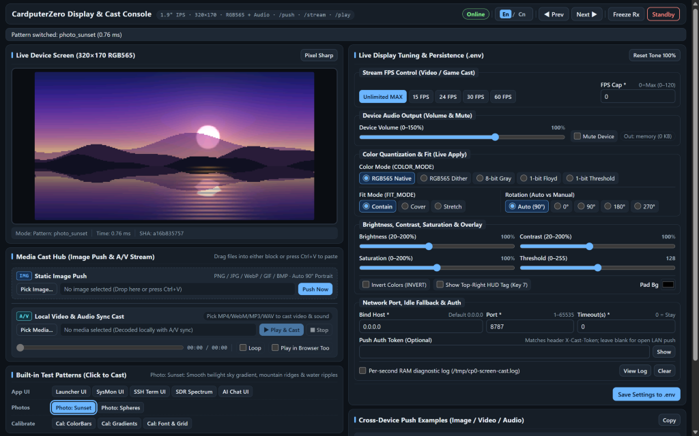
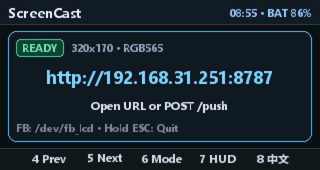
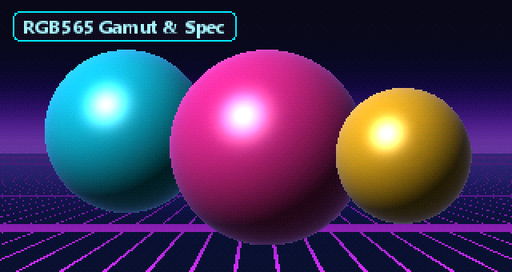
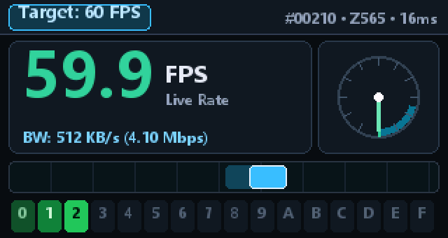

# CardputerZero Web Console & Wireless ScreenCast

**[中文](README.md)** | **English**

An all-in-one display evaluation, web control console, and high-speed wireless screen-casting application built for the **M5Stack CardputerZero** (Raspberry Pi CM0 `aarch64`, Debian 13, 1.9-inch ST7789v3 IPS color LCD, native `320 × 170` resolution, little-endian `16-bit RGB565`).

The service runs directly on the CardputerZero and listens on a LAN HTTP port (default `:8787`), providing three core capabilities:

1. **Self-Hosted Dual-Column Web Console**: Open `http://<device-ip>:8787` (shown on the device standby screen) from any PC or mobile browser to view a live `320 × 170` 16-bit quantized mirror of the screen, toggle `En / Cn` UI language, upload/drag-drop/`Ctrl+V` paste images, switch among **10 built-in evaluation patterns**, tune color quantization / Bayer anti-banding dither / scaling / rotation / brightness / contrast / saturation in real time, and control **stream frame pacing (`1–120 FPS` fixed cap or `0` unlimited)** for smooth video playback and game streaming.
2. **Open LAN Push Endpoint (`POST /push`)**: Any device, CLI script, or custom client on the LAN can push standard images (PNG / JPEG / BMP / WebP / GIF), raw `108,800`-byte little-endian `RGB565` frames, or `deflate` lossless compressed frames directly into `/dev/fb_lcd` (`/dev/fb0`) via zero-copy `mmap`.
3. **PC Multi-Rate Continuous FPS Benchmark Tool (`pc_fps_tester.py`)**: Includes both a `Tkinter` desktop GUI and a CLI sweep runner that continuously stream motion-calibrated FPS frames at `1–60 FPS` and `MAX` unlimited speed so you can measure real Wi-Fi throughput and visually inspect motion smoothness.

---

## Screenshots (En UI)

### Dual-Column Web Console (`http://<device-ip>:8787`)



### On-Device `320 × 170` Display Screens

| Standby Screen | Built-in Test Image | Live FPS Benchmark |
| :---: | :---: | :---: |
|  |  |  |

---

## 1. Display Specs & On-Device Benchmarks

| Item | Specification / Measured On-Device Result (CardputerZero 2.4GHz Wi-Fi) |
| --- | --- |
| Physical Display | 1.9" ST7789v3 IPS LCD, `320 × 170` pixels |
| Framebuffer | `/dev/fb_lcd` / `/dev/fb0` (little-endian `16-bit RGB565`, `640` bytes/line stride, `108,800` bytes/frame) |
| Runtime Dependencies | Python 3.11+ stdlib + `Pillow` (optional `evdev` on device for physical keypad; zero web framework dependencies) |
| `rgb565_zlib` Peak Throughput | **`180+ FPS`** (~`6–8 KB`/frame compressed, ~`2.1 ms` device decompress + blit; full `60 FPS` uses only ~`512 KB/s`) |
| `JPEG (4:4:4)` Peak Throughput | **`41+ FPS`** (~`15 KB`/frame, ~`21.5 ms` device decode + blit, ~`690 KB/s`) |
| `Raw RGB565` Peak Throughput | **`37+ FPS`** (`108,800` bytes/frame uncompressed, ~`2.8 ms` device blit, ~`4.0 MB/s` sustained Wi-Fi throughput) |
| Console FPS Pacing Accuracy | Under `MAX` unthrottled client push, setting `24 / 30 / 60 FPS` locks output to **`23.8 / 30.1 / 59.2 FPS`** |

---

## 2. Directory Layout

```text
ScreenCast/
├─ cp0_cast_app.py          On-device main service (HTTP server + Web UI + pixel pipeline + /dev/fb0 + evdev keypad)
├─ pc_fps_tester.py         PC local multi-rate continuous FPS tester (Tkinter desktop GUI + CLI sweep mode)
├─ build_deb.py             Pure-Python package builder (generates multi-size APPLaunch icons & arm64 .deb)
├─ deploy_to_device.ps1     PowerShell helper to upload and install the .deb over SSH
├─ .env.example             Configuration template with comments
├─ .gitignore               Git ignore rules (excludes .env, dist/, and temporary files)
├─ todo.md                  Project scope, sample pattern specs, and verification checklist
├─ README.md                Chinese documentation and client streaming guide
├─ README_EN.md             English documentation and client streaming guide
├─ assets/                  Generated APPLaunch icons and README preview screenshots
├─ web/                     Dual-column Web Console frontend (index.html / app.css / app.js)
└─ tests/                   Automated unit and end-to-end HTTP test suites
```

---

## 3. Installation, Startup & Daily Usage

### 3.1 Build `.deb` Package & Install on CardputerZero

No cross-compiler or Linux packaging toolchain is required on your PC. Build the `arm64` Debian package directly with Python from the project root:

```powershell
# 1. Generate icons and .deb package (outputs to dist/cp0-screen-cast_0.2.0_arm64.deb)
python "build_deb.py"

# 2. Upload and install over SSH (replace "cardputer" with your SSH alias or pi@<device-ip>)
powershell -ExecutionPolicy Bypass -File "deploy_to_device.ps1" -Target "cardputer"
```

You can also upload manually via `scp` and run `sudo dpkg -i /tmp/cp0-screen-cast_0.2.0_arm64.deb` on the device. Installation registers `/usr/share/APPLaunch/applications/cp0-screen-cast.desktop`, which `APPLaunch` picks up automatically via `inotify` without rebooting.

### 3.2 Launching from `APPLaunch` & Physical Keypad Controls

Select **`ScreenCast`** in the on-device `APPLaunch` launcher. The standby screen displays the active LAN URL (for example, `http://192.168.31.251:8787`).

| Physical Key | Action |
| --- | --- |
| `4` / `←` / `Z` | Previous built-in test pattern |
| `5` / `→` / `C` | Next built-in test pattern |
| `6` | Cycle color mode (`rgb565` -> `rgb565_dither` -> `gray` -> `mono_floyd` -> `mono_threshold`) |
| `7` | Show / hide top-right HUD tag (e.g., `CAST·30F·565`) |
| `8` / `L` | Toggle `En / Cn` UI language (abbreviated labels on the `320×170` screen, synced with Web Console) |
| Short `ESC` / `0` / `Backspace` | Clear current pattern/stream and return to the standby URL screen |
| **Hold `ESC` (~0.7 s)** | Quit `ScreenCast`, clear framebuffer, and return to `APPLaunch` |

To run `ScreenCast` as an always-on background service at boot instead of launching manually:

```bash
# Enable and start background systemd service
sudo systemctl enable --now cp0-screen-cast.service

# Disable background service (return to manual APPLaunch mode)
sudo systemctl disable --now cp0-screen-cast.service
```

### 3.3 Local Desktop Simulation (Without Hardware)

When started on Windows, macOS, or desktop Linux without `/dev/fb0`, `cp0_cast_app.py` automatically falls back to an in-memory virtual framebuffer so all HTTP APIs and the Web Console work locally:

```powershell
python "cp0_cast_app.py" --host 127.0.0.1 --port 8787
```

Open `http://127.0.0.1:8787/` in your browser.

### 3.4 Web Console & `.env` Configuration Reference

Open `http://<device-ip>:8787` to access the 50/50 dual-column Web Console:

- **Left Column**:
  - **Live Screen Mirror**: Reconstructed from exact `RGB565` framebuffer bytes, with a `Pixel Sharp / Smooth` view toggle.
  - **Quick Image Push**: Select a file, drag-and-drop onto the dashed zone, or press **`Ctrl+V` anywhere on the page** to paste a clipboard screenshot directly to the device screen.
  - **Local Video & Audio Cast**: Pick or drag-drop any `.mp4 / .webm / .mov / .mp3 / .wav` file in your PC or mobile browser to decode locally and stream synchronized `320×170 RGB565` frames + `24kHz PCM` audio to the device speaker/headphones, complete with play/pause, seek bar, loop, and local audio monitor controls.
  - **10 Built-in Test Patterns**: Launcher UI, SysMon dashboard, SSH terminal logs, SDR spectrum & waterfall, AI chat reader, sunset landscape photo, 3D shaded neon spheres, SMPTE color bars & gray steps, R/G/B/Gray gradient banding chart, and 1px bezel frame + `10–18px` font chart.
  - **Hardware & Stream Telemetry**: Current mode, received/blitted frame counts, live FPS & active FPS cap, framebuffer backend, endpoint IP, Wi-Fi strength, battery status, CPU temperature, and RAM usage.
- **Right Column**: Every tuning control previews live on the device within `120 ms` in memory (avoiding SD card wear) and writes to disk (`~/.config/cp0-screen-cast/cp0-screen-cast.conf` on device) when clicking **`Save Settings to .env`**.

| Key | Default | Valid Range & Description |
| --- | --- | --- |
| `UI_LANG` | `zh` | UI language: `zh` (Chinese) or `en` (English, concise abbreviations on device) |
| `TARGET_FPS` | `0` | **Stream FPS Cap**: `0` = unlimited full speed; `1–120` = fixed target frame rate for video playback & game casting |
| `COLOR_MODE` | `rgb565` | `rgb565` (native 16-bit), `rgb565_dither` (8×8 Bayer ordered dither against gradient banding), `gray`, `mono_floyd`, `mono_threshold` |
| `FIT_MODE` | `contain` | Aspect handling for non-`320×170` images: `contain` (letterbox), `cover` (crop to fill), `stretch` |
| `ROTATE` | `auto` | Rotation mode (mutually exclusive): `auto` (portrait images/videos auto-rotate `90°` CW, landscape stays `0°`) or manual `0`, `90`, `180`, `270` |
| `BG_COLOR` | `#000000` | Letterbox pad color in `contain` mode (`#RRGGBB`) |
| `BRIGHTNESS` | `100` | Brightness percentage (`20–200`) |
| `CONTRAST` | `100` | Contrast percentage (`20–200`) |
| `SATURATION` | `100` | Color saturation percentage (`0–200`) |
| `THRESHOLD` | `128` | Binary cutoff (`0–255`) for `mono_threshold` mode |
| `INVERT` | `false` | Invert image colors (`true` / `false`) |
| `SHOW_OVERLAY` | `false` | Overlay compact status tag at top-right of device screen (`true` / `false`) |
| `AUDIO_VOLUME` | `100` | Digital audio output volume percentage (`0–150`) |
| `AUDIO_MUTE` | `false` | Mute device audio output (`true` / `false`) |
| `DIAG_LOG` | `false` | Per-second RAM-disk diagnostic logger at `/tmp/cp0-screen-cast.log` (`256KB × 2` auto-rotation, zero SD card wear) |
| `LISTEN_HOST` | `0.0.0.0` | HTTP server bind address |
| `LISTEN_PORT` | `8787` | HTTP server port (`1–65535`) |
| `CAST_TOKEN` | empty | Optional auth token; when non-empty, write endpoints require header `X-Cast-Token: <token>` |
| `CAST_TIMEOUT_SEC` | `0` | Seconds of push inactivity before returning to standby screen (`0` = stay on last frame) |

---

## 4. Built-in PC Continuous FPS Tester (`pc_fps_tester.py`)

`pc_fps_tester.py` streams synthetic motion frames from your PC to the device using only Python stdlib (`tkinter`, `socket`) and `Pillow`, allowing you to measure network ceilings and see frame-rate differences directly on the LCD.

### 4.1 How the Visual Motion Indicators Work

Each frame draws four synchronized visual elements on the `320 × 170` canvas:

1. **Center `44px` Live FPS Readout**: Rolling-window measured FPS (emerald green when meeting >= 85% of target or in `MAX` mode; amber yellow when throttled by network or console FPS cap).
2. **Right 12-Spoke Frame Spinner**: Steps clockwise by `30°` on every single pushed frame (12 frames per revolution with an afterglow arc), turning into a smooth spinning dial at high frame rates.
3. **Bottom Track A (`1.5s` Constant-Speed Glider)**: Moves smoothly back and forth by wall-clock time, revealing stepiness at `2 / 5 FPS` versus fluid motion at `30 / 60 FPS`.
4. **Bottom Track B (`0–F` 16-Cell Frame Strobe)**: Advances strictly 1 cell per frame so any dropped frame or network hiccup is immediately visible.

### 4.2 Desktop GUI & CLI Commands

```powershell
# 1. Launch interactive desktop GUI (click 1/2/5/10/15/20/30/60/MAX buttons anytime)
python "pc_fps_tester.py" --host "192.168.31.251" --port 8787

# 2. Run automated CLI stepped sweep (2 -> 5 -> 10 -> 15 -> 20 -> 30 -> 60 -> MAX, 3.5s per tier, English HUD)
python "pc_fps_tester.py" --cli --sweep --host "192.168.31.251" --port 8787 --duration 3.5 --lang en

# 3. Benchmark a specific payload encoding at MAX speed (rgb565_zlib / jpeg / png / rgb565)
python "pc_fps_tester.py" --cli --host "192.168.31.251" --port 8787 --format jpeg --fps 0 --duration 5
```

---

## 5. Client Push Guide: From One-Line CLI to 60 FPS Game Streaming

The `POST /push` endpoint supports everything from simple one-off shell scripts to pipelined 60 FPS desktop/game streaming.

### 5.1 Level 1: One-Line CLI Push (`curl` / PowerShell)

Ideal for shell scripts, cron jobs, alerts, or quick testing:

```bash
# 1. Push a raw PNG or JPEG binary (any resolution; resized automatically on device)
curl -X POST "http://192.168.31.251:8787/push" \
  -H "Content-Type: image/png" \
  --data-binary "@demo.png"

# 2. Multipart form upload with per-request fit & anti-banding dither overrides
curl -X POST "http://192.168.31.251:8787/push?fit_mode=cover&color_mode=rgb565_dither" \
  -F "image=@photo.jpg"

# 3. Push with authentication header when CAST_TOKEN is configured
curl -X POST "http://192.168.31.251:8787/push" \
  -H "X-Cast-Token: your_secret_token" \
  -H "Content-Type: image/jpeg" \
  --data-binary "@card.jpg"
```

Windows PowerShell example:

```powershell
Invoke-RestMethod -Uri "http://192.168.31.251:8787/push" -Method Post -ContentType "image/png" -InFile ".\demo.png"
```

### 5.2 Level 2: Python Script for Dashboards & Status Cards (0.1–5 FPS)

Ideal for server monitors, home automation panels, weather cards, or sensor readouts:

```python
#!/usr/bin/env python3
"""Generate a native 320x170 status card and push it to CardputerZero via HTTP POST."""

import io
import json
from urllib.error import HTTPError, URLError
from urllib.request import Request, urlopen
from PIL import Image, ImageDraw

DEVICE_PUSH_URL = "http://192.168.31.251:8787/push"


def push_status_card(title: str, value: str, token: str = "") -> dict:
    # Draw at native 320x170 to keep text pixel-sharp
    img = Image.new("RGB", (320, 170), (15, 20, 28))
    draw = ImageDraw.Draw(img)
    draw.rounded_rectangle((10, 10, 309, 159), radius=8, fill=(24, 32, 44), outline=(56, 189, 248), width=2)
    draw.text((24, 28), title, fill=(148, 163, 184))
    draw.text((24, 68), value, fill=(52, 211, 153))

    buf = io.BytesIO()
    img.save(buf, format="PNG")

    headers = {"Content-Type": "image/png"}
    if token:
        headers["X-Cast-Token"] = token

    req = Request(DEVICE_PUSH_URL, data=buf.getvalue(), method="POST", headers=headers)
    try:
        with urlopen(req, timeout=5.0) as resp:
            return json.loads(resp.read().decode("utf-8"))
    except (HTTPError, URLError, TimeoutError) as exc:
        print(f"Push failed: {exc}")
        return {"ok": False, "error": str(exc)}


if __name__ == "__main__":
    print(push_status_card("NAS Storage", "Free: 4.82 TB"))
```

### 5.3 Level 3: Raw Little-Endian `RGB565` & Lossless `deflate` Fast Path

For minimal device CPU usage and maximum frame rates, clients can send pre-packed `320 × 170` little-endian `RGB565` frames directly into the framebuffer:

- **Frame Size**: Exactly `320 × 170 × 2 = 108,800` bytes (`2` bytes per pixel, row-major).
- **Little-Endian Bit Packing**: Given 8-bit `R, G, B` (`0..255`), the 16-bit value is `v = ((R & 0xF8) << 8) | ((G & 0xFC) << 3) | (B >> 3)`, stored as `[v & 0xFF, (v >> 8) & 0xFF]`.
- **Lossless Deflate Compression (Recommended)**: Compress the `108,800`-byte buffer with `zlib.compress(raw_bytes, level=1)` and send headers `Content-Type: application/octet-stream` + `Content-Encoding: deflate`. UI frames shrink by ~90% while decompressing and blitting in ~`2 ms` on the Cortex-A53.

### 5.4 Level 4: Synchronized Audio + Video Streaming (One-Line `ffmpeg` / `curl`)

`v0.2.0` supports **synchronized audio + video streaming** out of the box via three CLI workflows:

```bash
# Option A1 (Recommended One-Liner): PC scales & encodes compact MJPEG (-c:v mjpeg -q:v 7) — ~260 KB/s @ 24fps (90% less Wi-Fi traffic!)
ffmpeg -re -i "movie.mp4" \
  -vf "fps=24,transpose=clock:passthrough=landscape,scale=320:170:force_original_aspect_ratio=decrease,pad=320:170:(ow-iw)/2:(oh-ih)/2" \
  -c:v mjpeg -q:v 7 \
  -ar 24000 -ac 1 -c:a pcm_s16le \
  -flush_packets 1 -avioflags direct \
  -f avi "http://192.168.31.251:8787/stream"

# Option A2 (PC Hybrid CP0S Streamer): Zero-JPEG XOR delta on calm/dialogue frames + compact JPEG on scene cuts
python "pc_av_streamer.py" "movie.mp4" --host "192.168.31.251" --port 8787 --fps 24

# Option A3 (Uncompressed rawvideo AVI): Supports rgb565le or ?pix_fmt=bgr565le
ffmpeg -re -i "movie.mp4" -vf "fps=24,scale=320:170" -c:v rawvideo -pix_fmt rgb565le -ar 24000 -ac 1 -c:a pcm_s16le -f avi "http://192.168.31.251:8787/stream"

# Option B: Direct curl upload of a .wav or .mp4 file for on-device playback (.wav native; .mp4 uses device ffmpeg)
curl -X POST "http://192.168.31.251:8787/play" --data-binary "@clip.mp4"
curl -X POST "http://192.168.31.251:8787/play" --data-binary "@alert.wav"

# Option C: Stream raw 16-bit PCM audio directly to the device speaker/headphones
ffmpeg -re -i "music.mp3" -ar 24000 -ac 1 -f s16le "http://192.168.31.251:8787/audio?rate=24000&channels=1"
```

For custom Python scripts pushing deflate-compressed video frames over `/push`:

```python
#!/usr/bin/env python3
"""
Decode and scale a local video file to 320x170 rgb565le via ffmpeg and stream to CardputerZero.
Requires ffmpeg in PATH. Set TARGET_FPS (e.g. 24 or 30) in the Web Console for steady playback.
"""

import http.client
import socket
import subprocess
import sys
import zlib

FRAME_BYTES = 320 * 170 * 2  # 108,800 bytes


def stream_video_to_device(video_path: str, host: str = "192.168.31.251", port: int = 8787, fps: int = 24) -> None:
    cmd = [
        "ffmpeg",
        "-hide_banner",
        "-loglevel", "error",
        "-re",
        "-i", video_path,
        "-vf", f"fps={fps},scale=320:170:force_original_aspect_ratio=increase,crop=320:170",
        "-pix_fmt", "rgb565le",
        "-f", "rawvideo",
        "-",
    ]

    proc = subprocess.Popen(cmd, stdout=subprocess.PIPE)
    conn: http.client.HTTPConnection | None = None
    try:
        conn = http.client.HTTPConnection(host, port, timeout=5.0)
        conn.connect()
        if conn.sock is not None:
            conn.sock.setsockopt(socket.IPPROTO_TCP, socket.TCP_NODELAY, 1)

        while proc.stdout is not None:
            raw_frame = proc.stdout.read(FRAME_BYTES)
            if len(raw_frame) < FRAME_BYTES:
                break
            compressed = zlib.compress(raw_frame, level=1)
            try:
                conn.request(
                    "POST",
                    "/push",
                    body=compressed,
                    headers={
                        "Content-Type": "application/octet-stream",
                        "Content-Encoding": "deflate",
                        "Content-Length": str(len(compressed)),
                        "Connection": "keep-alive",
                    },
                )
                resp = conn.getresponse()
                resp.read()
            except (OSError, http.client.HTTPException) as net_err:
                print(f"Reconnecting: {net_err}")
                conn.close()
                conn = http.client.HTTPConnection(host, port, timeout=5.0)
    finally:
        if conn is not None:
            conn.close()
        proc.terminate()
        proc.wait(timeout=3.0)


if __name__ == "__main__":
    if len(sys.argv) < 2:
        print("Usage: python stream_video.py <video.mp4>")
        sys.exit(1)
    stream_video_to_device(sys.argv[1], fps=24)
```

### 5.5 Level 5: 30–60 FPS Low-Latency Desktop & Game Streaming

To stream a live game window, emulator, or desktop region at `30–60 FPS` over Wi-Fi, follow three networking practices:

1. **Reuse One Persistent TCP Socket with `TCP_NODELAY`**: Eliminates per-frame TCP handshakes.
2. **Coalesce Headers + Payload into One `sendall()`**: Standard HTTP clients often write headers and body in two separate `send()` calls, triggering `40–80 ms` Nagle + Delayed ACK stalls over Wi-Fi. Sending `header_bytes + payload` in a single `sock.sendall()` removes that stall completely.
3. **In-Order HTTP/1.1 Pipelining (3–4 Frames In-Flight) + Console FPS Cap**: Keep 3–4 frames in flight on the **same single TCP connection** (strictly FIFO, zero out-of-order frames) to overlap Wi-Fi air RTT with screen capture, while setting **`30 FPS`** or **`60 FPS`** in the Web Console so the device paces frames evenly and drops excess backlog spikes automatically.

Complete live screen-region streaming example (`Pillow.ImageGrab` works out-of-the-box on Windows/macOS; replace with `mss` on Linux):

```python
#!/usr/bin/env python3
"""
Capture a desktop/game region in real time and stream to CardputerZero via HTTP/1.1 pipelining.
Set TARGET_FPS to 30 or 60 in the Web Console for smooth, bounded-latency game pacing.
"""

import socket
import time
import zlib
from collections import deque
from PIL import Image, ImageChops, ImageGrab

R_HI = [i & 0xF8 for i in range(256)]
G_HI = [i >> 5 for i in range(256)]
G_LO = [(i << 3) & 0xE0 for i in range(256)]
B_LO = [i >> 3 for i in range(256)]


def pack_rgb565_deflate(img: Image.Image) -> bytes:
    """Pack a PIL image into deflate-compressed little-endian 320x170 RGB565 using C LUTs."""
    resized = img.resize((320, 170), Image.Resampling.BILINEAR).convert("RGB")
    r, g, b = resized.split()
    hi = ImageChops.add(r.point(R_HI), g.point(G_HI))
    lo = ImageChops.add(g.point(G_LO), b.point(B_LO))
    raw = Image.merge("LA", (lo, hi)).tobytes()
    return zlib.compress(raw, level=1)


def stream_desktop_region(host: str = "192.168.31.251", port: int = 8787, bbox=(0, 0, 1280, 680), pipeline: int = 3) -> None:
    while True:
        sock: socket.socket | None = None
        rfile = None
        inflight: deque[int] = deque()
        try:
            sock = socket.create_connection((host, port), timeout=4.0)
            sock.setsockopt(socket.IPPROTO_TCP, socket.TCP_NODELAY, 1)
            rfile = sock.makefile("rb", buffering=65536)
            print(f"Connected to {host}:{port}, streaming region {bbox} (Ctrl+C to stop)...")

            while True:
                while len(inflight) >= pipeline:
                    status_line = rfile.readline()
                    if not status_line:
                        raise ConnectionError("Connection closed by peer")
                    clen = 0
                    while True:
                        hl = rfile.readline()
                        if hl in (b"\r\n", b"\n", b""):
                            break
                        if hl.lower().startswith(b"content-length:"):
                            clen = int(hl.split(b":", 1)[1].strip())
                    if clen > 0:
                        rfile.read(clen)
                    inflight.popleft()

                frame_img = ImageGrab.grab(bbox=bbox)
                payload = pack_rgb565_deflate(frame_img)
                req_head = (
                    f"POST /push HTTP/1.1\r\n"
                    f"Host: {host}:{port}\r\n"
                    f"Content-Type: application/octet-stream\r\n"
                    f"Content-Encoding: deflate\r\n"
                    f"Content-Length: {len(payload)}\r\n"
                    f"Connection: keep-alive\r\n\r\n"
                ).encode("ascii")
                sock.sendall(req_head + payload)
                inflight.append(len(payload))
        except KeyboardInterrupt:
            print("Streaming stopped.")
            return
        except Exception as exc:
            print(f"Stream interrupted, reconnecting in 1s: {exc}")
            time.sleep(1.0)
        finally:
            if rfile is not None:
                try:
                    rfile.close()
                except Exception:
                    pass
            if sock is not None:
                try:
                    sock.close()
                except Exception:
                    pass


if __name__ == "__main__":
    stream_desktop_region()
```

*Tip: For photorealistic 3D games with heavy texture noise (where lossless `deflate` compresses less), encode `320 × 170` `JPEG (quality=80, subsampling=0)` without `Content-Encoding: deflate` using the same pipelined socket to sustain `30–40+ FPS`.*

---

## 6. HTTP API Reference

When `CAST_TOKEN` is non-empty in `.env`, all `POST` endpoints (except `/api/config` from the Web Console) require header `X-Cast-Token: <token>`.

| Method & Route | Description | Parameters / Request Body |
| --- | --- | --- |
| `GET /` | Dual-column Web Console HTML | Open in browser |
| `POST /push` | Push image or raw frame to screen | Raw encoded image bytes, `multipart/form-data` (`image` or `file` field), or `108,800`-byte little-endian `RGB565`; optional header `Content-Encoding: deflate`; optional query `?color_mode=...&fit_mode=...&rotate=...` |
| `POST /stream` | Single-connection live A/V stream | Accepts `ffmpeg -f avi` (recommended `-c:v mjpeg -q:v 7` or `rawvideo` `rgb565le` + `pcm_s16le`) and `CP0S` hybrid delta streams (`pc_av_streamer.py`); optional `?pix_fmt=bgr565le` |
| `POST /play` | Direct `curl` `.wav` / `.mp4` playback | Binary media body; `16-bit WAV` plays natively, `.mp4/.mkv/.mp3` decodes via on-device `ffmpeg` |
| `POST /audio` | Low-latency raw `S16_LE` PCM audio stream | Query `?rate=24000&channels=1` (`8000–96000 Hz`, mono or stereo) |
| `GET / POST /api/audio` | Query or update device volume & mute | JSON: `{"volume": 0..150, "muted": false, "clear": false, "save": false}` |
| `GET / POST /api/logs` | Read, toggle, or clear `/tmp` diagnostic log | `GET /api/logs?tail=120&format=text` returns plain text; `POST` accepts `{"action": "clear"}` or `{"enabled": true}` |
| `GET /api/patterns` | List all 10 built-in test patterns | Optional query `?lang=zh` or `?lang=en` |
| `POST /api/test-pattern` | Display a built-in test pattern | JSON: `{"pattern": "ui_dashboard"}` or `"next"` / `"prev"` |
| `GET /api/config` | Read active runtime configuration | Returns `{"ok": true, "config": {...}}` |
| `POST /api/config` | Update runtime configuration | JSON config map; `"save": false` applies live in memory, `"save": true` persists to `.env` |
| `POST /api/control` | Execute control command | JSON: `{"action": "waiting" \| "pause" \| "resume" \| "refresh" \| "next_pattern" \| "prev_pattern" \| "cycle_color_mode" \| "toggle_overlay" \| "toggle_lang"}` |
| `GET /preview.png` | Current screen as `320×170` PNG | Lazily encoded from framebuffer `RGB565` bytes and cached per `frame_seq` |
| `GET /health` | Service status, live FPS & telemetry | Returns mode, `frame_seq`, SHA-256, live FPS, frame/drop counters, IP, Wi-Fi, battery, CPU temp, and RAM |

---

## 7. Performance Profiling & Optimization Algorithms

CardputerZero runs on a Raspberry Pi CM0 (`aarch64` Cortex-A53, `353 MB` usable RAM, single-antenna `2.4GHz` SDIO Wi-Fi, SPI `320×170` ST7789v3 LCD). Sustaining smooth `24–30+ FPS` synchronized audio/video with low CPU overhead relies on four targeted optimization layers across transport, compression, pixel packing, and diagnostics.

### 7.1 Real-Device Bottleneck Benchmarks (24 FPS Movie Footage)

| Transport & Codec | Avg Frame Size | 24 FPS Bandwidth | On-Device Frame Time (`proc_avg`) | Bottleneck & Best Fit |
| --- | --- | --- | --- | --- |
| `rawvideo` (`rgb565le`) | `106.2 KB` | `2,550 KB/s` (`20.4 Mbps`) | `< 1.0 ms` | Saturates single-antenna 2.4GHz Wi-Fi; air retries trigger `200–400 ms` TCP head-of-line stalls |
| `RGB565 + deflate(1)` lossless | `60.9 KB` | `1,461 KB/s` (`11.7 Mbps`) | `~1.8 ms` | Camera sensor grain defeats `LZ77` dictionary compression on movies; ideal for crisp UI / terminal screens |
| **PC Temporal-Denoised `XOR-Delta + zlib(1)`** (`CP0S 0x02`) | `3–12 KB` (calm/dialogue)<br>`32.1 KB` (handheld motion) | `72–300 KB/s` (typical shots) | **`~1.5 ms`** (C `zlib` + big-int XOR, zero color conversion) | PC noise gate zeroes static background diffs; lowest device CPU cost |
| **PC Pre-Scaled `320×170 MJPEG` (`-q:v 7`) + NEON Pack** | **`9–13.1 KB`** | **`60–210 KB/s`** (measured movie avg) | **`5.04 – 5.95 ms`** | Cuts Wi-Fi traffic by **90%–95%**; resilient under Wi-Fi signal fluctuations |

### 7.2 Offloading Compute to PC & Browser

1. **`CP0S` Temporal Noise Gate + Hybrid XOR-Delta / JPEG (`pc_av_streamer.py`)**
   - **Temporal Noise Gate**: Computes per-pixel difference `ImageChops.difference(cur, prev)` on the PC and reuses the previous pixel wherever sensor grain is `<= 6`, making static background regions bit-identical after `RGB565` quantization.
   - **Big-Int Single-Pass XOR**: Converts the `108,800`-byte `RGB565` frame into a Python C big integer to compute `cur_int ^ prev_int` in one C pass, producing long zero runs compressed via `zlib(level=1)` (`0x02`). The device restores the framebuffer via `zlib` + one integer XOR without running JPEG decode or `RGB888 -> RGB565` conversion.
   - **Scene-Cut Fallback**: Automatically switches to compact `320×170` `JPEG` (`0x03`) when delta size exceeds `15 KB`, and inserts a fresh `0x01` keyframe once changed pixels drop below `16%`.
2. **Browser GPU Preprocessing & 3-Way In-Flight Pipelining (`web/app.js`)**
   - Combines portrait auto-`90°` detection (`videoHeight > videoWidth`), aspect scaling, and brightness/contrast/saturation/grayscale/invert into a single Canvas 2D GPU `ctx.filter` pass, followed by asynchronous C++ `castCanvas.toBlob('image/jpeg', 0.76)`.
   - Maintains a 3-deep concurrent request window (`MAX_VIDEO_INFLIGHT = 3`) with `X-Stream-Session` and `X-Frame-Seq` headers so out-of-order Wi-Fi retransmissions are dropped before decoding, while displaying `#cast-canvas` locally to eliminate reverse `/preview.png` polling traffic.

### 7.3 Cortex-A53 Pixel Pipeline & Lock-Free Fast Paths (`cp0_cast_app.py`)

1. **Native Pillow `RGBX` Export + `16-bit NEON` Vector Shifts (`4.52×` Faster on CM0)**
   - Pillow stores `"RGB"` images internally as 4-byte aligned `32-bit RGBX` (`image32`). Splitting into 3 channels and applying LUTs took **`10.72 ms`** per frame on the Cortex-A53 (`81%` of total frame time).
   - Exporting `img.tobytes("raw", "RGBX")` directly as a `(N, 2)` little-endian `uint16` `numpy` view `(rg, bx)` and computing `(((rg & 0x00F8) << 8) | ((rg & 0xFC00) >> 5) | ((bx & 0x00F8) >> 3))` keeps all operations in 16-bit ARM64 NEON SIMD registers, cutting packing time to **`2.37 ms`** and bringing end-to-end `MJPEG` frame processing (`libjpeg-turbo` `2.49 ms` + pack `2.37 ms` + `mmap` blit) down to **`5.04 – 5.95 ms`**.
2. **Cached HUD Patch & Direct `RGB565` Row Splicing**
   - Pre-renders and caches the small top-right HUD tag (`~64×16` px) along with its `RGB565` bytes (16-entry LRU) and splices those 16 rows directly into the `108,800`-byte buffer in `~0.03 ms`.
3. **Zero-Unpack `180°` Flip & `65536`-Entry PCM Volume LUT**
   - `180°` rotation reverses `54,400` `uint16` pixels in place via C `array('H').reverse()` (`< 0.15 ms`); `0–150%` digital audio gain uses a cached `65536`-entry `uint16` saturating lookup table.
4. **Lock-Free Decoding & Token-Bucket Micro-Pacing**
   - Image decoding, color packing, `/dev/fb0` writes, and lazy `/preview.png` encoding run outside `ScreenCastRuntime._lock`.
   - `_pace_and_blit_stream_batch` uses an 8-frame token bucket to smoothly play multi-frame `32 KB` HTTP `MJPEG` chunks with zero false drops while immediately shedding unthrottled flood frames prior to JPEG decoding; `AudioOutputSink` bounds queue latency and trips a circuit breaker on repeated player failures.

### 7.4 Zero-Wear RAM-Disk Telemetry Logger (`DiagRollingLogger`)

- When `DIAG_LOG` is enabled, hot-path threads only increment integer/float counters in RAM while a background worker writes 1 summary line per second to `tmpfs` `/tmp/cp0-screen-cast.log` (`256 KB × 2` auto-rotation, `<= 512 KB` total RAM, zero SD card writes), exposed remotely via `GET /api/logs?tail=100&format=text`.

---

## 8. Automated Tests & Validation

Run the full test suite and frontend syntax check from the project root:

```powershell
# Run all unit and end-to-end HTTP tests (service, .deb builder, and PC FPS tester)
python -B -m unittest discover -s "tests" -v

# Check Web Console frontend JS syntax
node --check "web/app.js"
```
